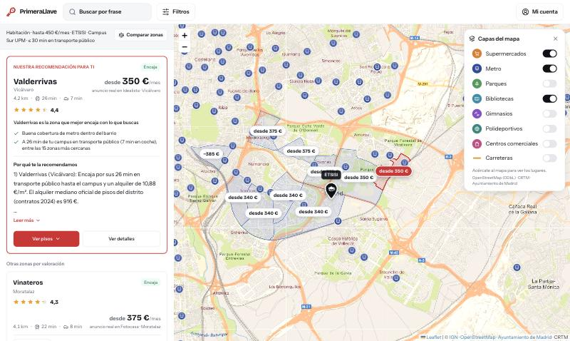
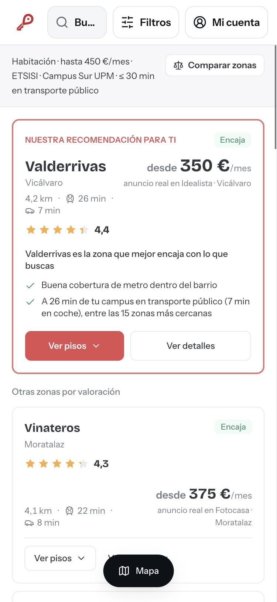

[](https://github.com/deegolol/CivicPulseAI_Commit-Pray/actions/workflows/ci.yml)

# 🔑 PrimeraLlave — tu primera llave en Madrid

**Dinos dónde vas a estudiar, cuánto puedes pagar y qué necesitas, y te decimos dónde buscar piso en Madrid:** qué zonas encajan contigo, cuánto te costará allí una habitación o un estudio según datos oficiales, y te llevamos directo a los anuncios ya filtrados.

### 👉 Demo en vivo: **https://primerallave.up.railway.app**

| Escritorio | Móvil |
|---|---|
|  |  |

Equipo **Commit & Pray** · Hackatón **CivicPulse AI** — 2Campus1Code (DA-ETSISI · DA-ETSIINF · Orange), noviembre de 2026.

---

## 🎯 El problema

Cada curso, miles de estudiantes llegan a Madrid sin conocer la ciudad y con un presupuesto ajustado. Los portales de anuncios enseñan pisos, pero no te dicen **qué zona te conviene**: cuánto se paga allí de verdad, a qué distancia queda tu campus, cómo es el aire o si está bien comunicada. Esa información existe, pero está repartida en datasets públicos difíciles de cruzar.

> **Lucía**, 18 años, empieza 1.º en la ETSISI (Campus Sur, Vallecas). Tiene 500 €/mes y no conoce Madrid. Escribe *"Estudio en la ETSISI y busco una habitación por menos de 450 € al mes, a menos de 30 minutos en transporte público"* y en segundos ve en el mapa las zonas que encajan, cuántos minutos tarda a clase en transporte público y en coche, y anuncios reales con su precio exacto.

## ✨ Qué hace

- **Búsqueda en lenguaje natural** — escribe lo que buscas; la IA lo convierte en campus, presupuesto, tipo de vivienda, tiempo máximo, modo de transporte y prioridades. Antes de llamar a la IA, un filtro sin IA descarta frases sin sentido, y las preguntas que no tratan de buscar vivienda no se buscan.
- **Tiempos reales puerta a puerta** al campus en **transporte público** (horarios oficiales del CRTM: Metro, Cercanías, Metro Ligero, EMT e interurbanos) y en **coche** (red de calles de OpenStreetMap). Nunca distancia en línea recta.
- **Mapa de los 131 barrios** con los minutos hasta tu campus y capas útiles (Metro, supermercados, bibliotecas, gimnasios, parques…).
- **Precios sin inventar**: alquiler oficial publicado por el Ministerio para cada barrio y anuncios reales con su precio exacto y enlace; nunca una estimación nuestra.
- **Controles en unidades reales**: €/mes, minutos, tipo de vivienda y lo que más te importa (sin porcentajes).
- **Top 3, detalle de cada zona y comparador** con las cifras y la fuente oficial de cada dato.
- **"Ver pisos en esta zona"** — enlaces a Idealista, Fotocasa y Badi ya filtrados por distrito y precio máximo (solo enlaces, sin scraping).
- **Explicación en lenguaje natural** del top 3, citando únicamente cifras reales.
- **Responsive**: mapa a pantalla completa y bottom sheet en móvil.

## 📊 Datos abiertos utilizados

Todos oficiales, descargados el 19/11/2026 y transformados con scripts reproducibles (`etl/`). Detalle completo de licencias, formatos y transformaciones en **[data/SOURCES.md](data/SOURCES.md)**.

| Indicador | Dataset | Organismo | Enlace |
|---|---|---|---|
| Geometría | Barrios municipales (131 barrios, 21 distritos) | Ayuntamiento de Madrid | [datos.madrid.es](https://datos.madrid.es/dataset/300496-0-barrios-madrid) |
| Alquiler (€/m²) | SERPAVI 2011–2024 · mediana del alquiler de vivienda colectiva (por distrito) | Ministerio de Vivienda y Agenda Urbana | [XLSX](https://cdn.mivau.gob.es/portal-web-mivau/vivienda/serpavi/2026-03_09_bd_SERPAVI_2011-2024%20-%20DEFINITIVO%20WEB_v2.xlsx) |
| Calidad del aire (NO₂) | Calidad del aire · datos horarios + estaciones de control | Ayuntamiento de Madrid | [datos horarios](https://datos.madrid.es/dataset/201200-0-calidad-aire-horario) · [estaciones](https://datos.madrid.es/dataset/212629-0-estaciones-control-aire) |
| Transporte | Estaciones de Metro (M4) · *Powered by CRTM* | Consorcio Regional de Transportes de Madrid | [crtm.es](https://www.crtm.es/) |
| Tiempo en transporte público | GTFS Metro, Cercanías, Metro Ligero, EMT e interurbanos · *Powered by CRTM* | Consorcio Regional de Transportes de Madrid | [datos.crtm.es](https://datos.crtm.es/) |
| Tiempo en coche | Red de calles de OpenStreetMap (motor OSRM) | © OpenStreetMap contributors (ODbL) | [osrm](https://project-osrm.org/) |
| Alquiler mensual (€/mes) | SERPAVI 2024 · alquiler mensual de pisos por **sección censal**, agrupado en los 131 barrios | Ministerio de Vivienda y Agenda Urbana · secciones censales del INE | mismo XLSX · [INE](https://www.ine.es/prodyser/cartografia/seccionado_2024.zip) |
| Servicios | Bibliotecas municipales · Centros deportivos municipales | Ayuntamiento de Madrid | [bibliotecas](https://datos.madrid.es/dataset/201747-0-bibliobuses-bibliotecas) · [polideportivos](https://datos.madrid.es/dataset/200186-0-polideportivos) |
| Campus | Ubicación de ETSISI y ETSIINF | Universidad Politécnica de Madrid | [ETSISI](https://www.etsisi.upm.es/ubicacion-como-llegar/) · [ETSIINF](https://dia.etsiinf.upm.es/index.php?pagina=166) |

**Cruce de fuentes:** cada barrio recibe el alquiler de su distrito, la media anual de NO₂ de la estación más cercana, la densidad de estaciones de Metro (paradas/km²) y el recuento de equipamientos dentro de su polígono (cruces espaciales con `shapely` en ETRS89/UTM 30N).

## 🏗️ Arquitectura

```
datos.madrid.es · MIVAU (SERPAVI) · CRTM · UPM        ← fuentes oficiales
                │   etl/*.py  (descarga, limpieza, reproyección, cruce espacial)
                ▼
data/processed/  barrios.geojson · indicators.json · campuses.json   (versionado y reproducible)
                │
                ▼
backend/  FastAPI (Python)
  ├─ scoring.py   motor de recomendación (puro y testeado)
  ├─ listings.py  enlaces a búsquedas filtradas en portales
  └─ llm.py       IA: OpenAI (gpt-5.6-luna) con JSON validado + modo sin IA
                │   API REST JSON (/api/…)
                ▼
frontend/ React + Vite + TypeScript + Tailwind + Leaflet + Recharts
                │
                ▼
Railway: un único contenedor (Dockerfile) — FastAPI sirve la API y el frontend compilado
```

**Cómo se calcula el encaje** (`backend/app/scoring.py`):
1. Cada indicador se normaliza de 0 a 1 entre los 131 barrios (min–max), donde 1 es siempre "mejor" (se invierte en alquiler, NO₂ y distancia). Un dato ausente cuenta como la mediana de la ciudad.
2. La distancia al campus se calcula en línea recta (haversine) desde el centroide del barrio.
3. Las prioridades del estudiante se convierten en pesos que suman 1, y el encaje es Σ normalizado × peso.
4. Presupuesto: **alquiler estimado = mediana oficial €/m² × m² de referencia** (habitación 25 m², estudio 35 m², piso 60 m²). Es una estimación con datos oficiales, no el precio de un anuncio.
5. Los filtros (presupuesto, distancia máxima) excluyen zonas sin alterar la puntuación de las demás.

**IA con los pies en el suelo** (`backend/app/llm.py`, `backend/app/prompts.py`):
- La IA **nunca genera datos**: solo (1) traduce la frase del estudiante a parámetros con un **JSON Schema estricto** construido a partir de nuestros campus e indicadores, que luego validamos y acotamos, y (2) redacta la explicación con las cifras que ya ha calculado nuestro motor.
- **Si falla o tarda** (8 s para entender, 12 s para explicar), la app sigue funcionando con un intérprete por palabras clave y una explicación por plantilla. Las frases del pitch están cacheadas para que la demo no dependa de la red.
- Regla de producto: la cercanía al campus siempre pesa al menos 0,6 (un estudiante va a clase cada día).

## 🚀 Ejecutar en local

Requisitos: **Python 3.11+**, **Node 20.19+** (o 22+) y `make`.

```bash
git clone https://github.com/deegolol/CivicPulseAI_Commit-Pray.git && cd CivicPulseAI_Commit-Pray
python3 -m venv .venv && source .venv/bin/activate
pip install -r backend/requirements.txt -r etl/requirements.txt
(cd frontend && npm install)
cp .env.example .env        # opcional: pon tu clave de OpenAI en LLM_API_KEY; sin clave funciona en modo sin IA
```

```bash
make dev      # API en http://localhost:8000 (docs en /docs) + web en http://localhost:5173
make check    # tests del backend (pytest) + build del frontend
make data     # regenera data/processed/ desde las fuentes oficiales (opcional: ya está versionado)
```

Sin `make`: `cd backend && uvicorn app.main:app --reload --port 8000` y, en otra terminal, `cd frontend && npm run dev`.

**Variables de entorno** (`.env`, nunca en git): `LLM_PROVIDER` (`openai` | `none`), `LLM_API_KEY`, `LLM_MODEL` (por defecto `gpt-5.6-luna`), `LLM_TIMEOUT_S`, `LLM_EXPLAIN_TIMEOUT_S`, `LLM_REASONING_EFFORT`, `DEMO_CACHE`.

**Despliegue:** Railway construye el `Dockerfile` de la raíz en cada push a `main` que toque código o datos (`railway.json`), con *healthcheck* en `/api/health`.

## 🔌 API

Documentación interactiva: **[/docs](https://primerallave.up.railway.app/docs)**. Arquitectura en [docs/ARCHITECTURE.md](docs/ARCHITECTURE.md).

| Método | Ruta | Para qué |
|---|---|---|
| GET | `/api/health` | Estado y origen de los datos (`processed` / `mock`) |
| GET | `/api/meta` | Indicadores, fuentes, campus y valores por defecto |
| GET | `/api/areas` · `/api/areas/{id}` | Barrios con sus valores; detalle con media del distrito y mediana de la ciudad |
| GET | `/api/geo` | Polígonos de los barrios (GeoJSON) |
| POST | `/api/score` | Ranking personalizado: encaje, desglose, alquiler estimado, ¿encaja en el presupuesto?, enlaces a anuncios |
| POST | `/api/ai/parse` | Frase en lenguaje natural → parámetros de búsqueda |
| POST | `/api/ai/explain` | Explicación del top 3 con cifras reales |

## 📁 Estructura

```
backend/        FastAPI: app/ (routers, scoring, listings, llm, prompts, models) y tests/
frontend/       React + Vite + TS: src/components (mapa, panel, detalle, comparador, IA), src/api
etl/            Scripts de descarga y transformación de cada fuente + run_all.py
data/           processed/ (salida versionada) y SOURCES.md (fuentes y licencias)
docs/           Capturas
Dockerfile · railway.json · Makefile
```

## 🤖 Uso de IA

Hemos trabajado 3 personas con varios agentes de IA (Claude Code, ChatGPT Codex y Gemini Antigravity) en paralelo sobre este mismo repositorio, con reglas comunes, tareas con dueño y contratos de API fijos. Detalle de qué hizo cada herramienta y qué revisaron los humanos en **[AI_USAGE.md](AI_USAGE.md)**.

## 🔎 De dónde sale cada número

- **Precio por barrio**: alquiler mensual oficial de pisos de los **131 barrios** (SERPAVI 2024), agrupando las 2.397 secciones censales de Madrid por barrio con los límites del INE (mediana ponderada por número de contratos). No calculamos ni estimamos precios.
- **Anuncios reales**: habitaciones publicadas en Fotocasa con su precio exacto, enlace y fecha de consulta. Los botones «Ver pisos con precio exacto» abren Fotocasa, Idealista y Badi ya filtrados por zona y presupuesto, con los anuncios del momento.
- **Tiempos de viaje**: transporte público con los horarios oficiales del CRTM en día laborable de 07:00 a 10:00 (incluida la espera según la frecuencia), desde las zonas habitadas de cada barrio; en coche, minutos de conducción por la red de calles de OpenStreetMap, sin contar el tráfico de ese momento.
- **IA**: solo interpreta la frase (con un filtro previo sin IA para frases sin sentido o fuera de tema) y redacta explicaciones con cifras que ya calculamos. Misma frase y mismas opciones → mismo resultado.

**Siguiente paso**: solicitar la API de Idealista para traer todos los anuncios y precios en tiempo real dentro de la app.

## 👥 Equipo — Commit & Pray

- **Diego** — API, motor de recomendación, IA y despliegue · coordinación de agentes
- **Adrián** — datos abiertos: fuentes, geometría, alquiler, documentación
- **TechGallo** — integración, CI, calidad y presentación

Licencia: ver [LICENSE](LICENSE).
